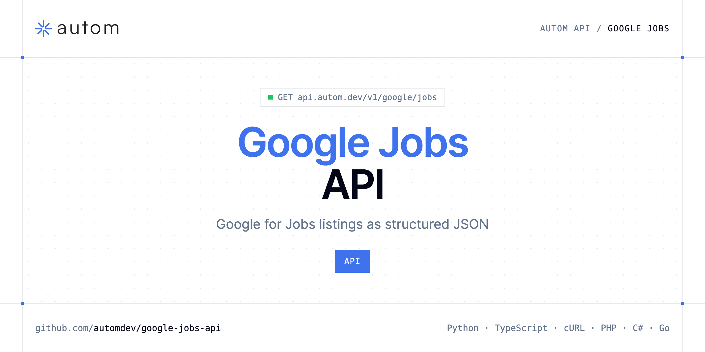

<p align="center">
  <a href="https://www.autom.dev"></a>
</p>

# Google Jobs API

[](https://discord.gg/CFj3ph8aHU) [](https://app.autom.dev/register) [](https://docs.autom.dev) [](LICENSE)

The **Autom Google Jobs API** returns Google for Jobs listings — title, company, location, source — as structured JSON.

- **Google Jobs API** — Scrape Google Jobs results via API and retrieve structured job listings with title, company, location, and pagination.

Use it for job boards, hiring signals or labour market analytics.

| Endpoint | Request | Credits |
|---|---|---|
| [Google Jobs API](#google-jobs-api) | `GET /v1/google/jobs` | 1 |

## Table of contents

- [How it works](#how-it-works)
- [Google Jobs API](#google-jobs-api)
- [Code examples in other languages](#code-examples-in-other-languages)
- [Use cases](#use-cases)
- [Why Autom?](#why-autom)
- [FAQ](#faq)
- [Related repositories](#related-repositories)
- [Support](#support)

## How it works

1. **Create a Autom account** and copy your API key from the [dashboard](https://app.autom.dev/register).
2. **Call `https://api.autom.dev`** with the header `x-api-key: YOUR_API_KEY`.
3. **Use the result** in your app — no infrastructure to run.

```bash
export AUTOM_API_KEY="your-api-key"
pip install requests        # Python
# TypeScript: Node.js 18+ (native fetch), run with `npx tsx file.ts`
```

## Google Jobs API

Scrape Google Jobs results via API and retrieve structured job listings with title, company, location, and pagination.

`GET https://api.autom.dev/v1/google/jobs` · **1 credit per request** · [API reference](https://app.autom.dev/openapi)

### Request parameters

| Parameter | In | Type | Required | Description |
|---|---|---|---|---|
| `query` | query | string | ✅ | The job search query to run on Google Jobs (e.g. `developer`, `barista new york`). |
| `uds` | query | string | — | Advanced search filters string for Google Jobs (encoded filter chips). |
| `lrad` | query | number | — | Search radius in kilometers. Does not strictly limit the radius, but influences result proximity. |
| `ltype` | query | number | — | Filter results by work type. Set to `1` to filter for work from home / remote jobs. |
| `location` | query | string | — | Human-readable location to originate the search from (e.g. `New York, NY`, `Paris, France`). If several locations match, the most popular one is used. Note: `location` and `uule` cannot be used together. |
| `uule` | query | string | — | Google encoded location parameter. Use for precise geo targeting. Note: `uule` and `location` cannot be used together. |
| `gl` | query | string | — | Country to use for the Google search (two-letter country code, e.g. `us`, `fr`). |
| `hl` | query | string | — | Language to use for the Google search (two-letter language code, e.g. `en`, `fr`). |
| `next_page_token` | query | string | — | Token to fetch the next page of results. Returned in the `serpapi_pagination.next_page_token` field of the previous response. |

### Python example

```python
import os

import requests

API_KEY = os.environ["AUTOM_API_KEY"]
HEADERS = {"x-api-key": API_KEY}

response = requests.get(
    "https://api.autom.dev/v1/google/jobs",
    headers=HEADERS,
    params={
        "query": "developer",
    },
    timeout=120,
)
response.raise_for_status()

data = response.json()
print(data)
```

### TypeScript example

```typescript
type GoogleJobsApi = {
  pagination?: {
    next_page_token?: string;
  };
  jobs_results?: {
    via?: string;
    title?: string;
    job_id?: string;
    location?: string;
    extensions?: string[];
    share_link?: string;
    company_name?: string;
  }[];
  search_parameters?: {
    q?: string;
    gl?: string;
    hl?: string;
    engine?: string;
  };
};

const headers = { "x-api-key": process.env.AUTOM_API_KEY!, "Content-Type": "application/json" };

const params = new URLSearchParams({
  "query": "developer",
});

const response = await fetch(`https://api.autom.dev/v1/google/jobs?${params}`, { headers });
if (!response.ok) throw new Error(`HTTP ${response.status}: ${await response.text()}`);

const data = (await response.json()) as GoogleJobsApi;
console.log(data);
```

### Output example

Example response from the API reference, abridged.

```json
{
  "pagination": {
    "next_page_token": "ErcDCvcCQU1uMy15UjdiWXVnYk1zZTV3aUk2bmtRQjNnVmpLUmp1VUV1d2F0dHVMVFJKTjREWXlXbDZGdWRERUZMNEJKZ1ZFa3dqd2FaTGFDQVltRktQYmRKbkdZTlVlUHZjcGRmZ…"
  },
  "jobs_results": [
    {
      "via": "via JOB TODAY",
      "title": "Barista",
      "job_id": "eyJqb2JfdGl0bGUiOiAiQmFyaXN0YSIsICJjb21wYW55X25hbWUiOiAiVmVsb2NjaSBDYWZlIiwgImFkZHJlc3NfY2l0eSI6ICJTdGF0ZW4gSXNsYW5kLCBOWSIsICJodGlkb2NpZ…",
      "location": "Staten Island, NY",
      "extensions": [
        "2 days ago",
        "19–21 an hour"
      ],
      "share_link": "https://www.google.com/search?ibp=htl;jobs&q=barista+new+york&htidocid=dQNDMQ_R7Yww_6YHAAAAAA%3D%3D&hl=en-US&shndl=37&shmd=H4sIAAAAAAAA_x…",
      "company_name": "Velocci Cafe"
    },
    {
      "via": "via JOB TODAY",
      "title": "Barista",
      "job_id": "eyJqb2JfdGl0bGUiOiAiQmFyaXN0YSIsICJjb21wYW55X25hbWUiOiAiVGhlIFNob3dyb29tIEJha2Vob3VzZSIsICJhZGRyZXNzX2NpdHkiOiAiQnJvb2tseW4sIE5ZIiwgImh0a…",
      "location": "Brooklyn, NY",
      "extensions": [
        "3 days ago",
        "16.50–17.00 an hour"
      ],
      "share_link": "https://www.google.com/search?ibp=htl;jobs&q=barista+new+york&htidocid=ljb56FK5QU7U3YEtAAAAAA%3D%3D&hl=en-US&shndl=37&shmd=H4sIAAAAAAAA_x…",
      "company_name": "The Showroom Bakehouse"
    }
  ],
  "search_parameters": {
    "q": "barista new york",
    "gl": "us",
    "hl": "en",
    "engine": "google_jobs"
  }
}
```

### Response fields

| Field | Type | Description |
|---|---|---|
| `pagination` | object |  |
| `pagination.next_page_token` | string |  |
| `jobs_results[]` | object[] |  |
| `jobs_results[].via` | string |  |
| `jobs_results[].title` | string |  |
| `jobs_results[].job_id` | string |  |
| `jobs_results[].location` | string |  |
| `jobs_results[].extensions` | string[] |  |
| `jobs_results[].share_link` | string |  |
| `jobs_results[].company_name` | string |  |
| `search_parameters` | object |  |
| `search_parameters.q` | string |  |
| `search_parameters.gl` | string |  |
| `search_parameters.hl` | string |  |
| `search_parameters.engine` | string |  |

## Code examples in other languages

Ready-to-run examples live in [`examples/`](examples); each reads your key from `AUTOM_API_KEY`.

| Language | `google-jobs` |
|---|---|
| cURL (Bash) | [google_jobs.sh](examples/curl/google_jobs.sh) |
| PHP | [google_jobs.php](examples/php/google_jobs.php) |
| C# | [GoogleJobs.cs](examples/csharp/GoogleJobs.cs) |
| Go | [google_jobs.go](examples/go/google_jobs.go) |
| Java | [GoogleJobsExample.java](examples/java/GoogleJobsExample.java) |
| Ruby | [google_jobs.rb](examples/ruby/google_jobs.rb) |
| Node.js | [google_jobs.mjs](examples/nodejs/google_jobs.mjs) |

## Use cases

- **Job aggregation** — Feed a job board with fresh listings.
- **Hiring signals** — Detect which companies are hiring for which roles.

## Why Autom?

- **Every SERP in one API** — Google Search, AI Mode, Maps, News, Shopping, Images, Videos, Jobs, Autocomplete, plus Bing and Brave.
- **Structured JSON** — documented fields instead of brittle HTML parsing.
- **Geo & language targeting** — search like a user from the country and language you need.
- **One API key, one header** — `x-api-key` on every request.
- **Copy-paste examples** — Python and TypeScript in each README, 7 more languages in `examples/`.

## FAQ

### How do I authenticate?

Create an account on [Autom](https://app.autom.dev/register), copy your API key and send it in the `x-api-key` header of every request to `https://api.autom.dev`.

### How much does a request cost?

Credits per call: `/v1/google/jobs` **1**. See [Autom pricing](https://www.autom.dev/pricing).

### Which languages are supported?

Any language that can make an HTTP request. This README shows Python and TypeScript; the [`examples/`](examples) folder contains cURL, PHP, C#, Go, Java, Ruby and Node.js.

## Related repositories

- [Google Search API](https://github.com/automdev/google-search-api)
- [Google AI Mode API](https://github.com/automdev/google-ai-mode-api)
- [Google Maps API](https://github.com/automdev/google-maps-api)
- [Google News API](https://github.com/automdev/google-news-api)
- [Google Shopping API](https://github.com/automdev/google-shopping-api)
- [Google Images API](https://github.com/automdev/google-images-api)
- [Google Videos API](https://github.com/automdev/google-videos-api)
- [Google Autocomplete API](https://github.com/automdev/google-autocomplete-api)
- [All Autom repositories](https://github.com/automdev)

## Support

- 💬 Join the [Discord](https://discord.gg/CFj3ph8aHU) to ask questions and share what you build.
- 📚 Read the [API reference](https://docs.autom.dev).
- 🔑 [Get your API key](https://app.autom.dev/register).

---

<p align="center">
  <a href="https://www.autom.dev">
    <picture>
      <source media="(prefers-color-scheme: dark)" srcset="images/logo-dark.svg">
      
    </picture>
  </a>
  <br>
  <sub>Built by <a href="https://www.autom.dev">Autom</a>. Examples are released under the MIT license.</sub>
</p>
